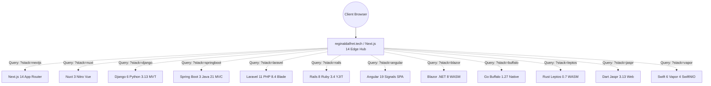

# 12 STACKS. 1 PRODUCT. — SYSTEM ARCHITECTURE SPECIFICATION

## Project Identity
- **Product Name**: 12 Stacks. 1 Product. (The Polyglot Portfolio Experiment)
- **Architect & Engineer**: Reginald Alfret V
- **Production Hub**: [https://reginaldalfret.tech](https://reginaldalfret.tech)

---

## High-Level Topology

---

## Architectural Breakdown of All 12 Implementations

### 1. Next.js 14 (TypeScript / React 18)
- **Role**: Primary Production Gateway & Central Engineering Laboratory
- **Runtime**: Node.js 24 / Vercel Edge Network
- **Rendering Pattern**: Hybrid React Server Components (RSC) + App Router Client Hydration
- **Key Characteristics**: Zero client JS for static server components, automatic code-splitting, Edge ISR.

### 2. Nuxt 3 (TypeScript / Vue 3)
- **Runtime**: Nitro Engine / Node.js
- **Rendering Pattern**: Universal Server-Side Rendering (SSR)
- **Key Characteristics**: Vue 3 Composition API with `<script setup>`, automated auto-imports, file-based routing.

### 3. Django 6 (Python 3.13)
- **Runtime**: Python 3.13 / Gunicorn / Nginx
- **Rendering Pattern**: Pure Server-Side Rendering (MVT)
- **Key Characteristics**: Zero client JS overhead, Python 3.13 JIT compilation, Django template inheritance.

### 4. Spring Boot 3 (Java 21 LTS)
- **Runtime**: GraalVM / OpenJDK 21 / Embedded Apache Tomcat
- **Rendering Pattern**: Server-Side Rendering (MVC + Thymeleaf)
- **Key Characteristics**: Project Loom virtual threads, type-safe models, enterprise dependency injection.

### 5. Laravel 11/12 (PHP 8.4)
- **Runtime**: PHP 8.4 / FrankenPHP / FPM
- **Rendering Pattern**: Server-Side Rendering (Blade Components)
- **Key Characteristics**: Artisan optimization, pre-compiled Blade partials, worker mode memory persistence.

### 6. Ruby on Rails 8 (Ruby 3.4)
- **Runtime**: Ruby 3.4 / YJIT / Puma
- **Rendering Pattern**: Server-Side Rendering (ActionView ERB)
- **Key Characteristics**: YJIT runtime compiler, Propshaft modern asset pipeline, convention-over-configuration.

### 7. Angular 19/22 (TypeScript 6.0)
- **Runtime**: Vite Bundler / Browser Client-Side SPA
- **Rendering Pattern**: Single Page Application (SPA)
- **Key Characteristics**: Zoneless change detection using Angular Signals, standalone component tree.

### 8. Blazor WebAssembly (.NET 8 / C#)
- **Runtime**: Mono WebAssembly Runtime in Browser
- **Rendering Pattern**: Client-Side WASM SPA
- **Key Characteristics**: Direct execution of compiled .NET 8 IL bytecode in browser VM, C# razor component lifecycle.

### 9. Go Buffalo (Go 1.27)
- **Runtime**: Standalone Native Statically Linked Go Binary
- **Rendering Pattern**: Native Compiled Server-Side Rendering (Plush)
- **Key Characteristics**: Ultra-low latency (< 40ms TTFB), goroutine concurrency, zero external dependencies.

### 10. Leptos 0.7 (Rust 1.85)
- **Runtime**: WebAssembly / Wasm-Bindgen
- **Rendering Pattern**: Fine-Grained Reactive Client-Side WASM
- **Key Characteristics**: Zero-cost signal abstractions, Rust memory safety guarantees, Trunk bundler.

### 11. Jaspr Web (Dart 3.13)
- **Runtime**: Dart Web Compiler / JS Runtime
- **Rendering Pattern**: Hydrated SSR & Reactive Tree
- **Key Characteristics**: Flutter-like syntax, Dart sound null safety, built-in hydration protocols.

### 12. Vapor 4 (Swift 6.0)
- **Runtime**: SwiftNIO Non-blocking EventLoop Binary
- **Rendering Pattern**: Server-Side Rendering (Leaf Engine)
- **Key Characteristics**: High-concurrency async/await, compile-time type-checked templates, zero-copy buffers.
